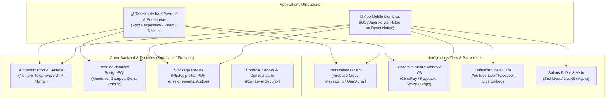

# Spécifications & Architecture Technique
**Écosystème Numérique d'Église (Mobile & Web)**

---

## 1. Schéma Général de l'Architecture

---

## 2. Choix Technologiques Recommandés

### A. Frontend (Application Mobile & Interface Web)
- **Option Recommandée : Flutter ou React Native (Expo)**
  - **Avantages** : Un code unique pour déployer simultanément sur **Android (Play Store)**, **iOS (App Store)** et même en version **Web (PWA)** accessible depuis n'importe quel navigateur sans installation préalable.
  - Expérience utilisateur fluide à 60 FPS, gestion native des notifications push et des autorisations (caméra, microphone).
- **Interface d'administration (Pasteur & Secrétariat)** :
  - Développée en Web moderne (React/Next.js ou intégrée dans l'application) pour une saisie rapide au clavier lors des cultes ou au bureau paroissial.

### B. Backend & Base de Données
- **Solution retenue : Supabase (BaaS sur PostgreSQL)**
  - **Pourquoi ?** 
    - Structure relationnelle idéale pour modéliser les membres, départements, présences et registres financiers.
    - Gestion native du temps réel (*Realtime subscriptions*) pour les annonces urgentes et les compteurs de prière.
    - **Sécurité RLS (Row Level Security)** : Crucial pour garantir la confidentialité des requêtes de prières privées et des données financières (un fidèle ne peut voir que ses propres données, seul le collège pastoral accède aux données sensibles).
    - Offre gratuite généreuse au démarrage (jusqu'à 50 000 utilisateurs actifs mensuels).

### C. Gestion des Paiements & Mobile Money (Module V2)
- **Agrégateur recommandé : CinetPay, Paystack ou KKiaPay**
  - Permet d'accepter en un seul point :
    - **Orange Money**, **MTN Mobile Money**, **Moov Money**, **Wave**.
    - Les cartes bancaires **Visa** et **Mastercard**.
  - Génération automatique de reçus numériques conformes pour les dîmes et offrandes.
  - Rapprochement bancaire simplifié pour le trésorier de l'église.

### D. Médias & Vidéos (Optimisation des coûts)
- **Cultes en direct & Replays** : 
  - Utilisation de l'API YouTube ou Facebook Video Player encapsulé dans l'application.
  - **Économie mensuelle estimée** : entre 300 $ et 1 500 $/mois de frais de bande passante évités.
- **Salons de Prière de Groupe (Audio/Vidéo)** :
  - **Phase 1 & 2** : Passerelle vers une instance dédiée **Jitsi Meet** (Open-source, sécurisée, sans frais de licence par utilisateur).
  - **Phase 3** : Intégration native WebRTC via **LiveKit** ou **Agora** pour une expérience 100% intégrée type WhatsApp.

---

## 3. Modèle de Données Clé (Entités Principales)

1. **`members`** (Membres) : `id`, `first_name`, `last_name`, `phone`, `email`, `role` (pasteur, secrétaire, diacre, membre), `department_id`, `joined_date`, `avatar_url`.
2. **`announcements`** (Annonces) : `id`, `title`, `content`, `category`, `priority`, `published_at`, `expires_at`, `author_id`.
3. **`prayers`** (Requêtes de prière) : `id`, `member_id`, `title`, `description`, `is_confidential` (booléen pastoral), `prayer_count`, `status`.
4. **`teachings`** (Enseignements & Médias) : `id`, `title`, `speaker`, `audio_url`, `pdf_url`, `video_id`, `date`.
5. **`events`** (Agenda) : `id`, `title`, `date_start`, `date_end`, `location`, `type` (culte, veillée, séminaire).
6. **`tithes_offerings`** (Dons & Dîmes) : `id`, `member_id`, `amount`, `currency`, `fund_type`, `payment_method`, `transaction_ref`, `status`.

---

## 4. Sécurité & Protection des Données Personnelles
- Chiffrement des communications de bout en bout (HTTPS / TLS 1.3).
- Chiffrement au repos des informations sensibles (coordonnées des membres, historiques de dons).
- Séparation stricte des rôles : le secrétariat gère le recensement sans avoir accès aux requêtes confidentielles adressées uniquement au Pasteur.
- Sauvegardes automatisées quotidiennes de la base de données.
